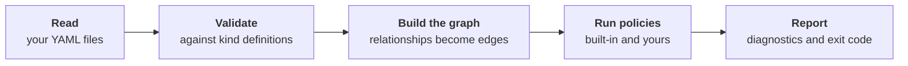
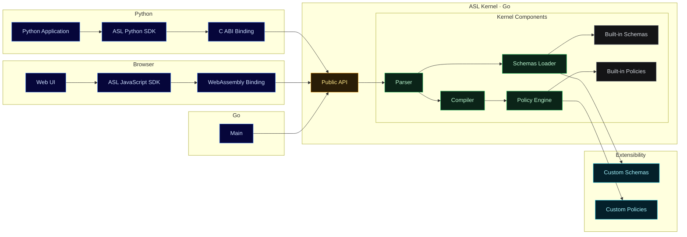

# How ASL works

:::warning[Work in progress]
This page is a work in progress. Content may change or be incomplete.
:::

You run `asl ./architecture` on your architecture folder and, a blink later, it says that two applications share `credit-db`. Nobody opened a diagram, and no model was asked for an opinion. What happened in that blink?

Five steps, always in the same order. The same input gives the same verdict every time, which is why it costs nothing to run on every commit.

## 1. Read

`asl` finds every `*.asl.yaml` in the folder you pass, including subfolders. One file can hold many manifests, separated by `---`. An empty folder is an error, so a wrong path never looks like success.

## 2. Validate

Every kind has a **definition**: which fields a manifest of that kind may have, which are required and which values are allowed. A manifest that does not match is reported as an error. You can add kinds of your own, or extend a built-in one, with [custom schemas](./custom-schemas.md).

## 3. Build the graph

Applications, databases and the other manifests become the nodes of a graph. Each entry of a `Relationship` becomes an edge between two of them, with a type such as `reads`, `writes` or `calls`. Along the way `asl` checks that:

- every `kind` is known;
- no two manifests share the same kind and name;
- every relationship points to manifests that exist.

A reference to something that does not exist is reported as an error.

## 4. Run policies

Built-in policies run first, then your [custom policies](./custom-policies.md). Policies look at the whole graph, which is how a rule like "a database belongs to a single application" is possible: no single manifest knows the answer.

## 5. Report

Problems are printed one block each, with the file and line. Errors turn into exit code `1`, and warnings do not fail the run. Nothing stops at the first problem: you see everything in one go. See [CLI](./cli.md) for the format.

## Where ASL runs

Your architects use the terminal. Your platform team wants the same check inside an internal portal. A data team wants it in a Python script. All of them must get the same verdict, or the rules stop being rules.

That is why the checking logic is one piece, and everything else is a thin layer around it: the `asl` command for terminals and CI, a browser and Node build, a Python binding, and Go programs. Custom schemas and custom policies plug in from the outside, without changing anything inside.

You choose where it runs. The rules, and the verdict, stay the same.
