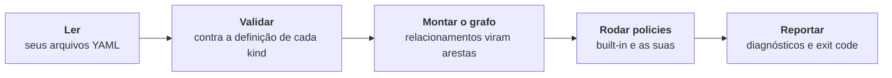
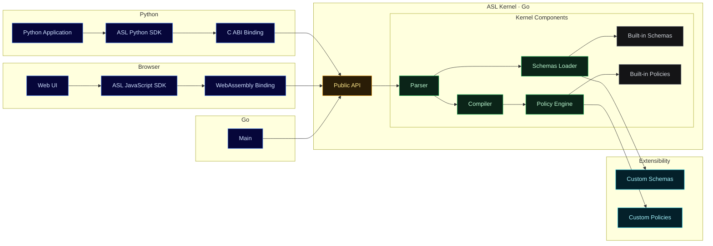

# Como o ASL funciona

:::warning[Em construção]
Esta página está em construção. O conteúdo pode mudar ou estar incompleto.
:::

Você roda `asl ./architecture` na pasta da sua arquitetura e, num piscar de olhos, ele avisa que duas aplicações dividem o `credit-db`. Ninguém abriu um diagrama, e nenhum modelo foi consultado. O que aconteceu nesse piscar?

Cinco etapas, sempre na mesma ordem. A mesma entrada dá o mesmo veredito toda vez, e é por isso que não custa nada rodar a cada commit.

## 1. Ler

O `asl` encontra todo `*.asl.yaml` na pasta que você passar, incluindo subpastas. Um arquivo pode ter vários manifests, separados por `---`. Uma pasta vazia é um erro, então um path errado nunca parece sucesso.

## 2. Validar

Todo kind tem uma **definição**: quais campos um manifest daquele kind pode ter, quais são obrigatórios e quais valores são aceitos. Um manifest que não bate com ela é reportado como erro. Você pode criar kinds próprios, ou estender um built-in, com [custom schemas](./custom-schemas.md).

## 3. Montar o grafo

Aplicações, bancos e os demais manifests viram os nós de um grafo. Cada item de um `Relationship` vira uma aresta entre dois deles, com um tipo como `reads`, `writes` ou `calls`. No caminho, o `asl` confere que:

- todo `kind` é conhecido;
- não existem dois manifests com o mesmo kind e nome;
- todo relacionamento aponta para manifests que existem.

Uma referência para algo que não existe é reportada como erro.

## 4. Rodar policies

As policies built-in rodam primeiro, depois as suas [custom policies](./custom-policies.md). As policies enxergam o grafo inteiro, e é assim que uma regra como "um banco pertence a uma única aplicação" é possível: nenhum manifest sozinho sabe a resposta.

## 5. Reportar

Os problemas saem um bloco por vez, com arquivo e linha. Erros viram exit code `1`, e warnings não fazem a execução falhar. Nada para no primeiro problema: você vê tudo de uma vez. O formato está em [CLI](./cli.md).

## Onde o ASL roda

Os seus arquitetos usam o terminal. O seu time de plataforma quer a mesma checagem dentro de um portal interno. O time de dados quer num script Python. Todos precisam receber o mesmo veredito, ou as regras deixam de ser regras.

Por isso a lógica de checagem é uma peça só, e todo o resto é uma camada fina em volta dela: o comando `asl` para terminal e CI, um build para navegador e Node, um binding para Python e programas em Go. Custom schemas e custom policies entram por fora, sem mudar nada por dentro.

Você escolhe onde roda. As regras, e o veredito, continuam as mesmas.
